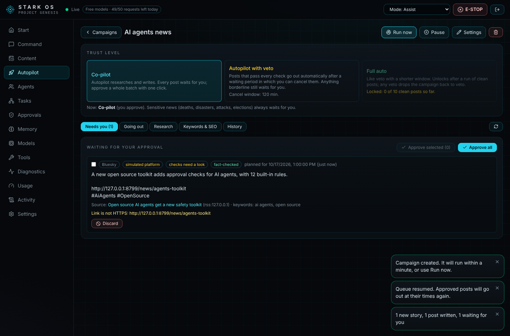

# Autopilot: set-and-forget social media, with guard rails

Autopilot runs a **campaign** for you. You describe it once: what to post about, where to find stories, which platforms, when, and how much to trust it. Then STARK OS researches, picks keywords and hashtags, writes, fact-checks, schedules and learns from engagement, every few hours, while it's running.

## Quick start

1. Open the dashboard and go to **Autopilot → New campaign**.
2. Fill in:
   - **Topics** and **SEO keywords**, for example `AI agents, open source`.
   - **Sources**, for example a Hacker News search for `ai agents`, an RSS feed from a blog you trust, or the subreddit `MachineLearning`.
   - **Platforms** and **posting times**, for example `09:00, 13:00, 18:00` in your time zone.
3. Keep the trust level on **Co-pilot** for the first days. Press **Run now**, or wait a minute.
4. Check **Needs you** and press **Approve all**, or select individual posts. Approved posts go out at their planned times.

## What happens on every run

| Step | What Autopilot does | Who does it |
|---|---|---|
| Research | Reads every source. It skips stories it has seen (same link or a near-identical headline) and scores the rest by relevance to your topics and keywords, freshness, popularity (Hacker News points, Reddit votes) and how well their keywords did before. Stories below the threshold are kept as "skipped" so you can see why. | Code |
| SEO | Picks the campaign keywords that appear in the story. Ranks them by the average engagement they earned on earlier posts, and gives new keywords a fair chance. Turns them into CamelCase hashtags (`#AiAgents`, which screen readers can read) within each platform's limit: 2 on X, 3 on Bluesky/LinkedIn, 4 on Mastodon. | Code |
| Writing | One request writes a version for every platform in the campaign, within each platform's character budget. The model writes the text only. **STARK OS adds the source link and hashtags**, and removes any link or hashtag the model invented. | E.D.I.T.H. (free model) |
| Fact-check | One more request compares every version with the source article, which is fetched if its robots.txt allows. | JOCASTA (free model) |
| Quality gate | Platform policy check (length, leaked keys, personal data, disclosure, bait...), numbers that are not in the source, links other than the source, @mentions, near-duplicates of earlier posts, sensitive news topics, the fact-check verdict, and your "never post about" words. | Code |
| Scheduling | Fills your posting times within the next 36 hours, with a maximum number of posts per platform per day and a minimum gap between posts. | Code |

A story costs **two free-model requests**: writing and the fact-check. With the defaults (a run every 6 hours, at most 2 new stories per run) a campaign uses at most about 16 of your 50 free requests a day.

## Trust levels

| Level | What goes out on its own | Default |
|---|---|---|
| **Co-pilot** | Nothing. Every post waits in **Needs you**; approve one, a selection, or all with one click. If a planned time passes without your approval, the post goes back to drafts and its slot is freed. | ✅ new campaigns |
| **Autopilot with veto** | Posts that pass **every** check are scheduled no earlier than the end of your cancel window (default 120 min, minimum 30). You can cancel them in **Going out** until then. Anything borderline waits for you. | |
| **Full auto** | Like veto with a shorter window (minimum 10 min). It **unlocks only after 10 clean, real (not simulated) posts in a row from this campaign** (posts you approved or let through). **Any cancel drops the campaign back to veto**, and the count starts again. | locked |

Whatever the level, these always wait for you:

- **Sensitive subjects**: deaths, disasters, attacks, wars, elections, layoffs, abuse.
- **Failed or uncertain fact-checks.**
- **Numbers that aren't in the source.**

## Safety rails (in code)

- **Emergency stop** and the **queue pause** stop Autopilot completely. Nothing runs and nothing is posted until you resume.
- **Pause a campaign** at any time. Its pending posts are paused too, and the ones Autopilot approved on its own go back to **Needs you**, so nothing it queued goes out by itself after you resume.
- **Stopping always reaches posts already queued.** Lowering the trust level, switching a campaign off or cancelling one of its posts withdraws every approval Autopilot gave on its own. Posts you approved yourself keep your approval.
- **Changes during a run count.** Before each post is queued, Autopilot re-reads the campaign. If you paused it, switched it off, lowered its trust, deleted it or pulled the emergency stop while it was writing, the new posts wait for you (or, for a deleted campaign, are not created).
- **Discarding an Autopilot post on the Content page counts as a cancel.**
- **Automatic pauses:**
  - **Possible crisis in your mentions:** a legal threat, a data leak, safety, fraud. Checked at most every 5 minutes on connected Bluesky/Mastodon accounts. A mention that already paused a campaign doesn't pause it again after you resume.
  - **Publishing failed twice in a row:** usually a disconnected account.
  - **Engagement collapse:** the last 3 posts got less than 30% of the campaign's usual engagement. The campaign also drops to Co-pilot.
- **An approval covers one exact text.** Every Autopilot approval is tied to the post's fingerprint, as with posts you schedule yourself. Any edit cancels it.
- **Untrusted input.** Feed items, Reddit posts and articles are passed to the model inside a marked block as data. The model never controls links, hashtags, timing or which platform is used, and the gate checks its output.
- **Safe fetching.** Every feed and article is fetched through the same SSRF guard as the research tools (public addresses only, redirects re-checked, size limits). Feeds with a DOCTYPE or entity declaration are refused. Reddit posts marked NSFW are skipped.
- **Audit log.** Every Autopilot action is written to the **Activity** log with the actor `autopilot`.

## Sources

| Source | Needs a key? | Notes |
|---|---|---|
| RSS / Atom feed | no | Any blog, newsroom or YouTube channel feed. |
| Hacker News search | no | Stories from the last 3 days via the public Algolia API. |
| Subreddit (top today) | no | Reddit sometimes blocks automated reads; when it does, the run reports it and carries on. |
| Web news search | `TAVILY_API_KEY` or `BRAVE_API_KEY` | Both have free tiers. |

There is no Google Trends source because Google has no public API for it.

## Platforms

Autopilot writes text posts for **Bluesky, Mastodon, X, Threads, LinkedIn and Facebook Pages**.

- **Bluesky and Mastodon** post for real once connected (**Content → Your accounts**).
- **The other platforms** are published as labelled simulations, the same as everywhere else in STARK OS. Copy the text and post it yourself.
- **Instagram, TikTok and YouTube** need images or video, so Autopilot doesn't support them.

## Learning from results

Every 3 hours Autopilot reads likes, reposts, replies and quotes for its real posts from the last 14 days. It then updates **Keywords & SEO**: posts and average engagement per keyword, where engagement = likes + 2 × (reposts + replies + quotes). Better keywords rank higher when choosing hashtags and scoring new stories. Simulated posts never get invented numbers.

## Settings reference

| Setting | Default | Range |
|---|---|---|
| Posting times | 09:00, 13:00, 18:00 | up to 12, in the campaign's time zone |
| Max posts per platform per day | 3 | 1–10 |
| Minimum minutes between posts | 120 | 15–1440 |
| Look for stories every | 6 h | 1–48 h |
| New stories per run | 2 | 1–5 |
| Cancel window | 120 min | 30–1440 (veto), 10–1440 (full auto) |
| Source link | always | always / never |
| Fact-check | on | on / off (numbers are still checked against the source) |

## API

Every Autopilot endpoint needs the API token.

- `GET` and `POST /api/autopilot/campaigns`
- `GET`, `PATCH` and `DELETE /api/autopilot/campaigns/{id}`
- `POST /api/autopilot/campaigns/{id}/run`
- `POST /api/autopilot/campaigns/{id}/pause?paused=true|false`
- `POST /api/autopilot/approve` with `{items: [{id, fingerprint}]}`
- `POST /api/autopilot/items/{id}/veto`
- `GET /api/autopilot/digest?hours=24`

STARK OS must be running (`make dev`) for campaigns to run and scheduled posts to go out.
